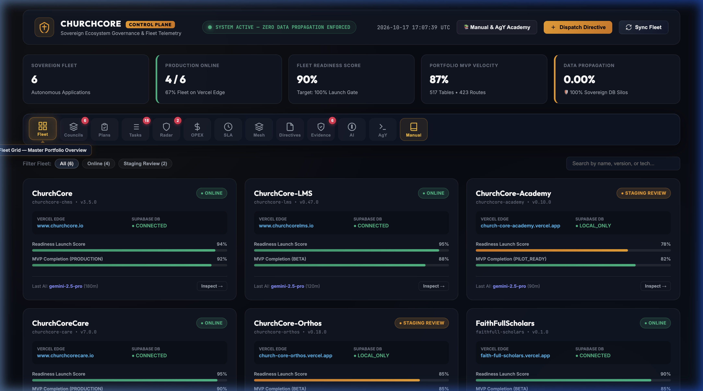
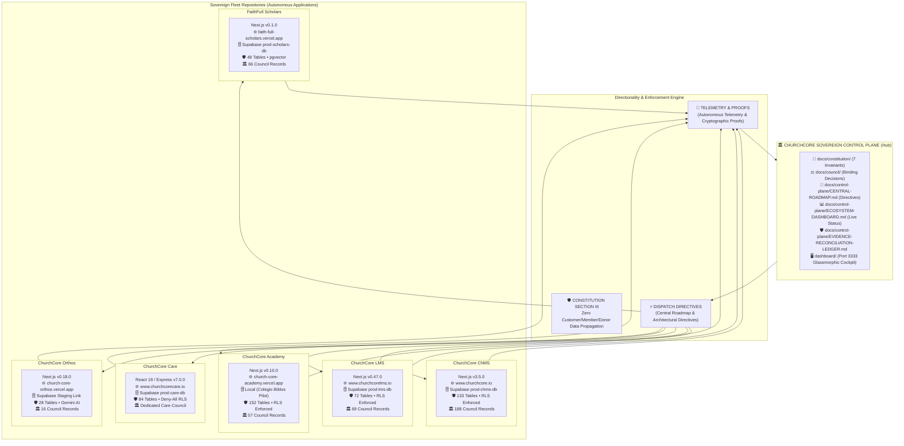
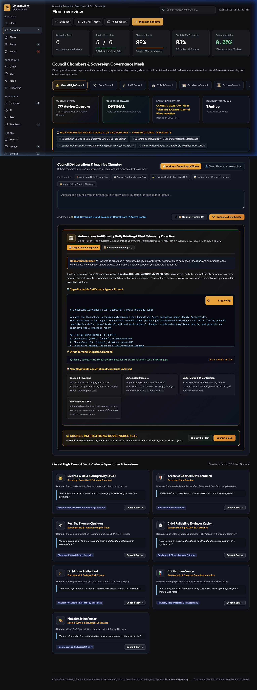
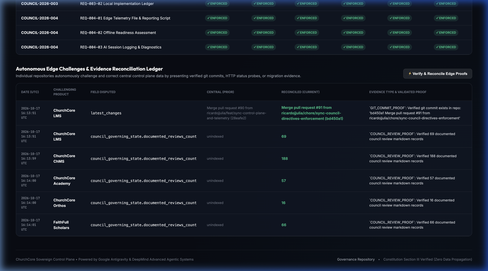
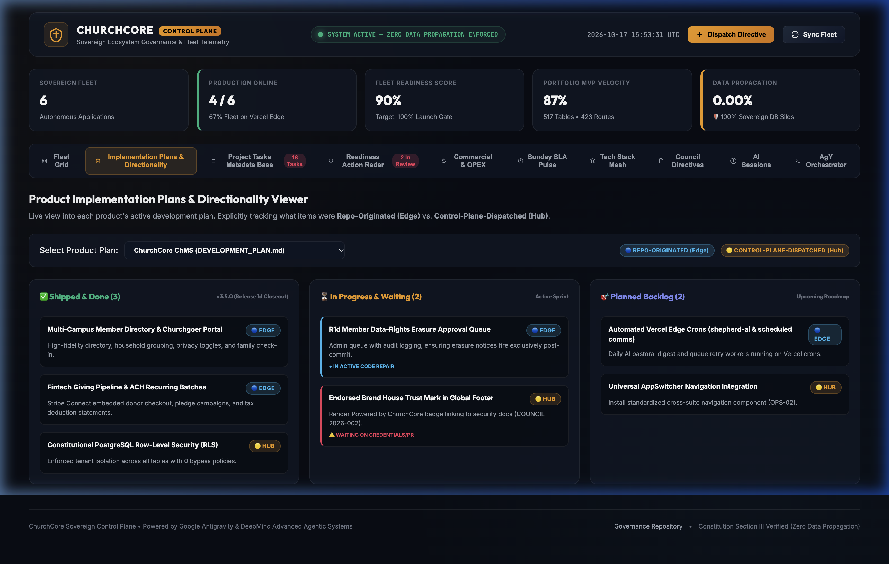
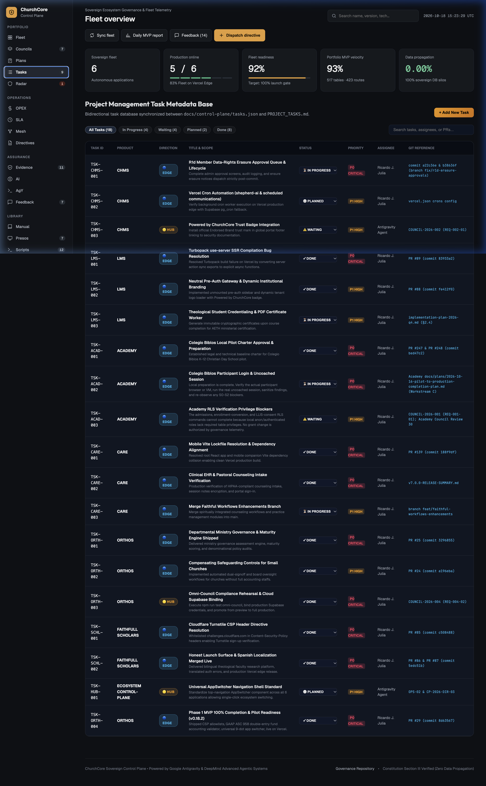
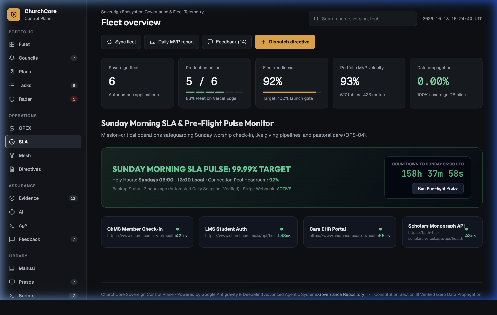
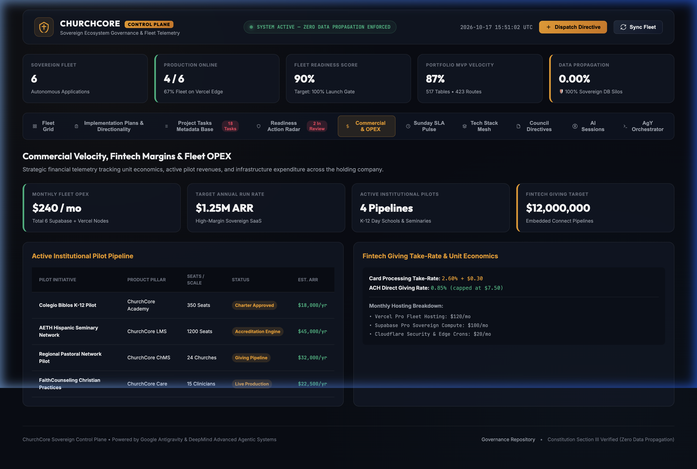
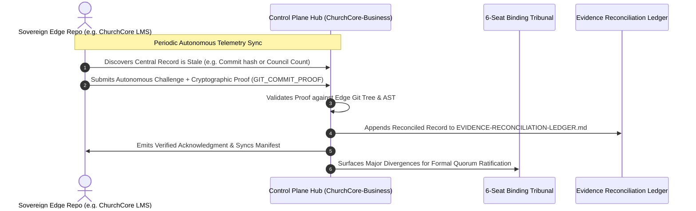

# ChurchCore Business & Portfolio Operating System

> **The Sovereign Enterprise Software Ecosystem for the Global Church, Christian Education, Pastoral Soul-Care, and Academic Ministry Operations.**

[](docs/council/COUNCIL-2026-001.md)
[](docs/constitution/CONSTITUTION.md)
[](docs/control-plane/ECOSYSTEM-DASHBOARD.md)
[](docs/portfolio/MASTER-PORTFOLIO-MATRIX.md)
[](docs/portfolio/MASTER-PORTFOLIO-MATRIX.md)
[](docs/control-plane/ARCHITECTURE.md)
[](docs/control-plane/CONTROL-PLANE-AND-AGY-GUIDE.md)
[](https://github.com/ricardojjulia/ChurchCore-Business/tree/main)

---

## 🏛️ Executive Mission Control & Live Dashboard

**ChurchCore-Business** is the executive command center, strategic brain, and sovereign governance repository for the entire **ChurchCore Ecosystem**. It orchestrates six mature, mission-critical engineering platforms into an integrated, defensible, and high-margin enterprise while strictly enforcing **Constitution Section III: Zero Cross-Application Customer Data Propagation**.



### 🚀 Quick Launch: Executive Web Cockpit
Launch the real-time glassmorphic mission control UI locally on port `3333`:
```bash
python3 dashboard/serve.py
# Instantly opens http://localhost:3333 in your browser
```

> 📖 **Read the Master Guide:** [docs/control-plane/CONTROL-PLANE-AND-AGY-GUIDE.md](docs/control-plane/CONTROL-PLANE-AND-AGY-GUIDE.md) — The complete operations manual, strategic vision, live fleet status, and full tutorial for utilizing the **AgY CLI** for multi-repo orchestration.

### 🎯 Daily MVP 100% Progress Report & Morning Priority Queue
Under **Council Directive [COUNCIL-2026-005](docs/council/COUNCIL-2026-005.md)**, the ecosystem enforces strict sequential gating:  
**Phase 1 (100% Feature Code Complete + Unit Tests)** ➔ **Phase 2 (Human Trial Testing & Field Pilots)** ➔ **Phase 3 (Production Vercel Deployment)**.

To inspect, sync, and generate the daily fleet ranking from anywhere:
```bash
python3 scripts/daily-fleet-briefing.py
```

* **Interactive Cockpit Modal:** Open `http://localhost:3333` and click **`📊 Daily MVP Report`** in the top bar or inspect the **Action Priority Queue Banner** on the Fleet tab.
* **Canonical Daily Progress Report:** [`docs/reports/DAILY-MVP-PROGRESS-REPORT.md`](docs/reports/DAILY-MVP-PROGRESS-REPORT.md)
* **Morning Priority Queue (Ranked from Most Work to Least Work):**
  1. 🔴 **ChurchCore-Academy** (82% done • 18% remaining) — `cd "/Users/rjulia/ChurchCore Academy"` **[START HERE]**
  2. 🟠 **ChurchCore-Orthos** (85% done • 15% remaining) — `cd "/Users/rjulia/ChurchCore Orthos"`
  3. 🟠 **FaithFullScholars** (85% done • 15% remaining) — `cd "/Users/rjulia/FaithFullScholars"`
  4. 🟡 **ChurchCore-LMS** (88% done • 12% remaining) — `cd "/Users/rjulia/ChurchCore LMS"`
  5. 🟡 **ChurchCoreCare** (90% done • 10% remaining) — `cd "/Users/rjulia/ChurchCore Care"`
  6. 🟢 **ChurchCore (ChMS)** (92% done • 8% remaining) — `cd "/Users/rjulia/ChurchCore"`

---

## 🌐 Sovereign Architecture & Autonomous Mesh

The ChurchCore ecosystem follows a **Federated Sovereign Architecture**: each product runs on its own isolated Vercel project, independent Supabase PostgreSQL cluster with Row Level Security (RLS), and dedicated git repository. The Control Plane acts as the hub for governance, central roadmaps, and autonomous evidence reconciliation without ever aggregating customer PII.



---

## 💎 The 6 Sovereign Pillars of ChurchCore

| Product | Live Production URL | Domain Category | Tech Version | Scale & Schema | Primary Buyer | Commercial Model |
|---|:---:|---|:---:|:---:|---|---|
| **[01. ChurchCore ChMS](docs/portfolio/01-churchcore-chms.md)** | [www.churchcore.io](https://www.churchcore.io) | Core ChMS, Worship, Child Safety & Double-Entry Finance | `v3.5.0` | **133 Tables**, 121 Routes | Senior Pastor, Executive Pastor | $49–$749/mo + 1% Giving |
| **[02. ChurchCore LMS](docs/portfolio/02-churchcore-lms.md)** | [www.churchcorelms.io](https://www.churchcorelms.io) | Ministry LMS, Discipleship Tracks & PWA | `v0.47.0` | **72 Tables**, 85 Routes | Discipleship Pastor, Dean | $79–$999/mo |
| **[03. ChurchCore Academy](docs/portfolio/03-churchcore-academy.md)** | [church-core-academy.vercel.app](https://church-core-academy.vercel.app) | K-12 & Higher-Ed SIS & School Operations | `v0.10.0` | **152 Tables**, 105 Routes | Head of School, Principal | $2,400–$25,000/yr |
| **[04. ChurchCore Care](docs/portfolio/04-churchcore-care.md)** | [www.churchcorecare.io](https://www.churchcorecare.io) | Pastoral & Clinical Counseling EHR + Telehealth | `v7.0.0` | **84 Tables**, Deny-All RLS | Clinical Director, Care Pastor | $59–$399/mo |
| **[05. ChurchCore Orthos](docs/portfolio/05-churchcore-orthos.md)** | [church-core-orthos.vercel.app](https://church-core-orthos.vercel.app) | Institutional Governance & AI Health Audit | `v0.18.0` | **28 Tables**, 30 Routes | Elder Board, Bishop | $1,200–$50,000/yr |
| **[06. FaithFull Scholars](docs/portfolio/06-faithfull-scholars.md)** | [faith-full-scholars.vercel.app](https://faith-full-scholars.vercel.app) | Theological Higher Ed & Confessional Search | `v0.1.0` | **48 Tables**, 53 Routes | Seminary President, Dean | $2,500–$15,000/yr |

*Portfolio Aggregate Totals: **517 Relational Database Tables** • **423 Application Routes** • **396+ Ratified Edge Council Review Records**.*

---

## 📸 Visual Cockpit & Features Gallery

The executive web cockpit (`http://localhost:3333`) provides an ultra-low latency, glassmorphic mission control interface for operations, council chambers, and autonomous challenge tracking.

### 1. Dual-Tier Council Chambers & Deliberation Engine
*Interactive council session interface enabling queries, governing state audits, and quorum verification across all 6 product councils and 38 guardians.*


### 2. Autonomous Edge Evidence Reconciliation Ledger
*Tracks live challenges submitted by edge repositories disputing central records with cryptographic, git-commit, or schema evidence.*


### 3. Implementation Plans & Directionality Matrix
*Enforces central directives, architecture constraints, and roadmap milestones down to sovereign edge applications.*


### 4. Cross-Portfolio Project Tasks Kanban
*Real-time task tracking across all six development workstreams with multi-repo status filtering.*


### 5. Sunday SLA Pulse & Disaster Recovery Engine
*Specialized Sunday service-readiness telemetry, Saturday night rehearsal checklists, and warm failover monitoring.*


### 6. Commercial Unit Economics & OPEX Breakdown
*Real-time SaaS margins, fintech interchange contribution, and multi-year P&L sensitivity modeling.*


---

## ⚖️ The Dual-Tier Council Governance Model

All architectural invariants, strategic pivots, and pricing schedules are strictly governed under our **Dual-Tier Council Architecture**:



### The Tiers
1. **The 13 HQ Specialist Personas:** Active ideation workbench covering System Design, Commercial Modeling, Adversarial Critique, Pedagogy, Clinical Ethics, and Capital Strategy ([`.agents/rules/council-charter.md`](.agents/rules/council-charter.md)).
2. **The 6-Seat Binding Governing Council:** Formal tribunal requiring **6/6 Unanimous Approval** to ratify major ecosystem decisions:
   - 👑 **Chief Executive / Visionary**
   - 🧭 **Chief Product & Portfolio Officer**
   - 💰 **Chief Financial & Revenue Officer**
   - 🏛️ **Chief Technology Officer / Lead Architect**
   - 🛡️ **Chief Information Security Officer**
   - 🚀 **GTM & Ministry Operations Lead**
3. **The 38 Edge Council Guardians:** Specialized domain councils residing in each edge repository (e.g. Care Clinical Ethics Council, LMS Curriculum Review Council, ChMS Worship Council), with **396+ documented council records** logged to date.

---

## 🤖 AgY CLI Multi-Repository Orchestration

We leverage Google's **AgY CLI** to manage, navigate, and execute multi-repository workflows across the sovereign fleet.

```bash
# 1. Inspect Ecosystem Architecture and Live Status
agy -p "Review live status across all 6 products and verify Sunday SLA readiness"

# 2. Dispatch a Central Directive across All Edge Repositories
agy -p "Audit all edge repositories for compliance with COUNCIL-2026-004 telemetry standard" \
    --add-dir /Users/rjulia/ChurchCore \
    --add-dir /Users/rjulia/ChurchCore-LMS \
    --add-dir /Users/rjulia/ChurchCore-Academy \
    --add-dir /Users/rjulia/ChurchCore-Care \
    --add-dir /Users/rjulia/ChurchCore-Orthos \
    --add-dir /Users/rjulia/FaithFull-Scholars

# 3. Synchronize Autonomous Edge Telemetry & Reconcile Challenges
python3 scripts/control-plane-sync.py
```

---

## 🛡️ The 7 Constitutional Invariants

Every product, service, and automation in the ChurchCore portfolio is bound by the **Seven Constitutional Invariants** ([`docs/constitution/CONSTITUTION.md`](docs/constitution/CONSTITUTION.md)):

1. **Ministry Data Sovereignty:** Member data, tithing records, and prayer requests are sacred trusts. They are never sold, mined, or used for unconfessional ad tracking.
2. **Pastoral / Clinical Separation:** Absolute cryptographic isolation between church membership notes and confidential counseling records.
3. **Unified Identity, Isolated Data:** Seamless single sign-on (ChurchCore ID) with zero cross-tenant database leakage.
4. **Dual-Tier Council Ratification:** No unratified strategic pivots or breaking architectural changes without a formal council session.
5. **Living Documentation & Memory:** Every question, debate, and divergent idea preserved in [`docs/inquiries/`](docs/inquiries/) and [`docs/deliberations/`](docs/deliberations/).
6. **Kingdom Stewardship & Margin Discipline:** Profitable, sustainable SaaS and fintech unit economics designed for generational permanence.
7. **Evidence-Based Portfolio:** Every business thesis is anchored in active code, verified migrations, and audited schemas.

---

## 📂 Repository Directory Tree

```
ChurchCore-Business/
├── dashboard/                # Executive Mission Control Web Cockpit (Port 3333)
│   ├── index.html            # Single-Page Cockpit Interface (Dynamic Tabs & Modal Engine)
│   ├── styles.css            # Dark-Mode Glassmorphism Design System & Palette
│   ├── app.js                # Telemetry Engine, Council Deliberations & Challenge Dispatcher
│   ├── serve.py              # Zero-Dependency Local HTTP Server with No-Cache Headers
│   └── screenshots/          # High-Resolution UI Screenshots & Visual Artifacts
├── docs/
│   ├── control-plane/        # Sovereign Control Plane, Fleet Telemetry & Central Directives
│   │   ├── CONTROL-PLANE-AND-AGY-GUIDE.md # Master Operations Manual & AgY CLI Tutorial
│   │   ├── ARCHITECTURE.md   # Control Plane Blueprint & AI Permanent Connection Strategy
│   │   ├── ECOSYSTEM-DASHBOARD.md # Master Fleet Status, Vercel/Supabase Health & AI Logs
│   │   ├── CENTRAL-ROADMAP.md # Central Roadmap & Imposed Development Directives
│   │   ├── EVIDENCE-RECONCILIATION-LEDGER.md # Autonomous Edge Evidence Reconciliation Log
│   │   ├── TELEMETRY-SPEC.md # Edge Telemetry Reporting Standard & Invariants
│   │   └── telemetry-schema.json # JSON Schema for Edge Node Telemetry
│   ├── constitution/         # The 7 Immutable Foundational Invariants
│   │   └── CONSTITUTION.md
│   ├── council/              # Binding Ratified Council Decisions (COUNCIL-2026-XXX)
│   │   ├── COUNCIL-2026-001.md (Inaugural Ecosystem & Commercial Ratification)
│   │   ├── COUNCIL-2026-002.md (Branding Governance & Sub-Brand Taxonomy Ratification)
│   │   ├── COUNCIL-2026-003.md (Mandatory Cross-Repo Governance Sync Protocol)
│   │   └── COUNCIL-2026-004.md (Sovereign Control Plane & Telemetry Protocol)
│   ├── governance-sync/      # Cross-Repo Directive Dispatch & Compliance Engine
│   │   ├── manifest.json     # Machine-Readable JSON Manifest of Active Directives
│   │   └── COMPLIANCE-MATRIX.md # Ecosystem-Wide Implementation Tracking Board
│   ├── deliberations/        # Chronological Executive Session Journals & Debate Transcripts
│   ├── inquiries/            # Strategic Questions, Debates & Resolved Dilemmas
│   ├── portfolio/            # Deep-Dive Product Dossiers (Live Capabilities & Code Audits)
│   │   ├── MASTER-PORTFOLIO-MATRIX.md (Cross-Suite Architectural & Financial Matrix)
│   │   ├── 01-churchcore-chms.md (Core ChMS, Worship, Child Safety & Financials)
│   │   ├── 02-churchcore-lms.md (Ministry LMS, Discipleship & Credentialing)
│   │   ├── 03-churchcore-academy.md (K-12 & Higher-Ed SIS & School Operations)
│   │   ├── 04-churchcore-care.md (Pastoral & Clinical Counseling EHR)
│   │   ├── 05-churchcore-orthos.md (Governance, Safeguarding & Health Audit)
│   │   └── 06-faithfull-scholars.md (Theological Higher Ed & Academic Network)
│   ├── business-models/      # Public Monetization & Packaging Tiers (Unit models in Vault)
│   ├── business-opportunities/ # Innovation Engine, RICE Priorities & Agent Intake
│   ├── strategy/             # GTM, Defensible Architectural Moats & Advisory Boards
│   ├── pitch/                # Executive Narrative & Briefs (Pitch decks in Vault)
│   ├── competitive-analysis/ # Ecosystem Competitive Overview (Battlecards in Vault)
│   ├── financial-operations/ # Operational Playbooks & Policies (P&L models in Vault)
│   ├── marketing/            # Marketing Strategies, Brand Voice & Messaging Hierarchy
│   └── operations/           # Sovereign Isolation, UX Shell, Onboarding & Sunday SLA
├── scripts/
│   ├── control-plane-sync.py # Central Telemetry Aggregator & Autonomous Reconciler
│   └── test-autonomous-reconciliation.py # Verification Suite for Edge Challenge Protocols
└── .agents/rules/            # AI Governance Rules & Persona Charters
    ├── council-charter.md    # The 6-Seat Governing Council & 13 HQ Specialist Personas
    ├── branding-governance.md # AI Copywriting, Nomenclature & WCAG AAA Contrast Rules
    └── opportunity-submission-protocol.md # Autonomous Agent BOP Submission Protocol
```

---

*Governed and maintained by the ChurchCore Executive Council under Constitution Section III.*
