# AxiomSRE: Closed-Loop Architecture & Invariant Specification

## 1. Executive Summary

AxiomSRE is a formal Site Reliability Engineering (SRE) and governance framework designed for multi-application software fleets developed in collaboration with autonomous AI coding agents.

Traditional agent orchestrators rely on top-down **Command & Control** dispatching. When scaling beyond a few services, this approach fails mathematically: **instruction feedback latency and state desynchronization trap autonomous agents in infinite verification loops.**

AxiomSRE resolves this by establishing:
1. **Air-Gapped Domain Sovereignty**: Each service owns its database, deployment, and tests.
2. **Autonomous Edge Telemetry**: Continuous edge-to-hub reporting on test runs and commits.
3. **The Bidirectional Loop-Breaker Protocol**: Mathematical proof-of-work required for instruction state transitions.
4. **Constitutional Invariant Boundaries**: Zero customer data serialization in telemetry or AI pipelines.

---

## 2. The Mathematical Failure of Open-Loop Agentic Governance

Let $S_{hub}$ be the central state containing a backlog of directives $D = \{d_1, d_2, \dots, d_n\}$.  
Let $S_{edge}$ be the state of an edge application, and $I_{edge}$ be the active instruction provided to an autonomous AI agent in that repository.

### The Open-Loop Failure Theorem (Infinite Directive Loop)
In an open-loop system:
1. Hub dispatches directive $d_k$ to the edge: $I_{edge} \leftarrow d_k$.
2. Agent executes $d_k$, commits code $C$, and runs tests $T$.
3. However, $S_{hub}$ does not update until a human manual review or an external webhook fires.
4. On the next session pre-flight or context-compaction restart, the agent re-reads $I_{edge}$ or polls $S_{hub}$.
5. Because $S_{hub}$ still records $d_k$ as active, the agent disputes the task or re-implements $d_k$, discarding its prior work.

$$\lim_{t \to \infty} P(\text{Agent Re-executes Completed Work}) = 1.0$$

---

## 3. The AxiomSRE Solution: Closed-Loop Dual Mutation Protocol

AxiomSRE breaks the cycle by enforcing an **Evidence-Backed Challenge & Simultaneous Dual Mutation Protocol**:

```mermaid
sequenceDiagram
    autonumber
    actor DevOrAgent as Edge Coding Agent
    participant EdgeRepo as Sovereign Edge Repository
    participant ProofEngine as challenge-central.py
    participant CentralHub as AxiomSRE Reconciler (Hub)
    participant Cockpit as Glassmorphic Dashboard

    DevOrAgent->>EdgeRepo: Implements Feature & Commits (Hash: 9dfcc2d)
    DevOrAgent->>EdgeRepo: Runs Test Suite (posttest auto-hook)
    EdgeRepo->>ProofEngine: Generates Evidence Payload (Git Commit + Test Pass)
    ProofEngine->>CentralHub: Submits Cryptographic Challenge
    CentralHub->>CentralHub: Cryptographic / Local Verification of Evidence
    
    rect rgb(20, 30, 45)
        note over CentralHub,EdgeRepo: SIMULTANEOUS DUAL MUTATION (Atomic Transition)
        CentralHub->>CentralHub: Mutates fleet-data.json & logs to Ledger
        CentralHub->>EdgeRepo: Mutates edge mvp-100-plan.md ([x] checked, Banner -> d_{k+1})
        CentralHub->>Cockpit: WebSocket / Polling Pulse triggers instant UI update
    end

    Note over DevOrAgent,EdgeRepo: Next session immediately sees d_{k+1}. Loop broken!
```



### Supported Proof Types:
1. **`GIT_COMMIT_PROOF`**: Specific SHA-1 / SHA-256 commit hash verified in git tree.
2. **`TEST_PASS_PROOF`**: Structured test runner exit code `0` and test assertion count.
3. **`HTTP_STATUS_PROOF`**: Live edge HTTP 200 response with response-time SLA check.
4. **`FILE_EXISTENCE_PROOF`**: AST-verified presence of new modules, schemas, or migrations.

---

## 4. Constitutional Invariant: Zero Customer Data Propagation

```
+-------------------------------------------------------------------+
|               CONSTITUTIONAL INVARIANT (SECTION III)              |
|                                                                   |
|   Telemetry payloads, watcher daemons, GitHub actions, and LLM    |
|   prompts SHALL NEVER extract, serialize, ingest, or transmit    |
|   customer database rows, user PII, or confidential credentials.   |
|                                                                   |
|   Permitted Data: Git metadata, build logs, route paths, HTTP     |
|   status codes, latency percentiles, error codes, presentation    |
|   slide outlines.                                                 |
+-------------------------------------------------------------------+
```

By enforcing this boundary at the JSON schema layer, teams can safely connect frontier cloud models (Gemini, Claude, GPT-4) without violating HIPAA, GDPR, SOC 2, or enterprise privacy agreements.
