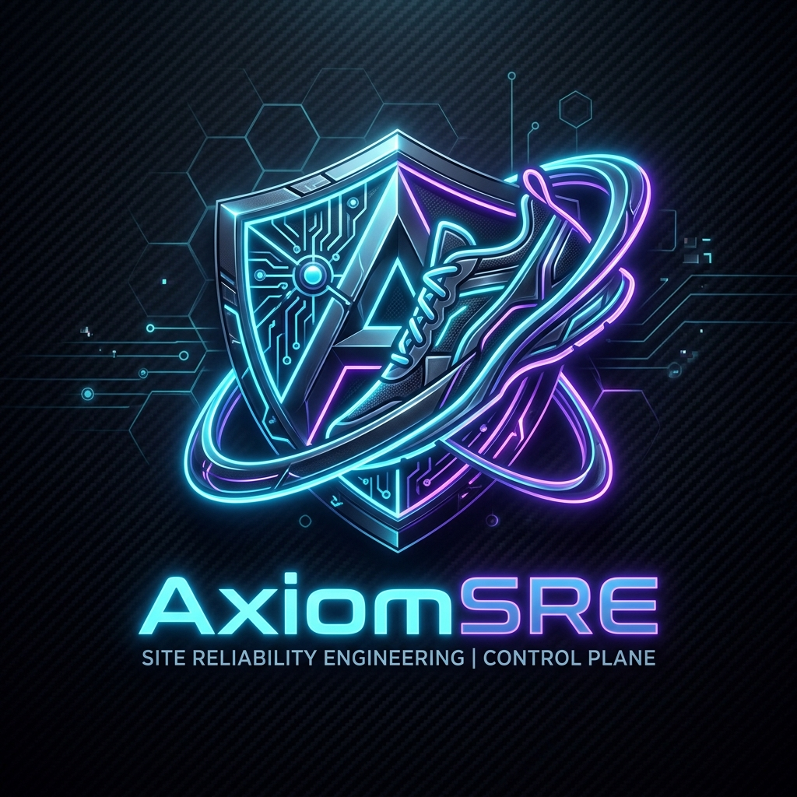
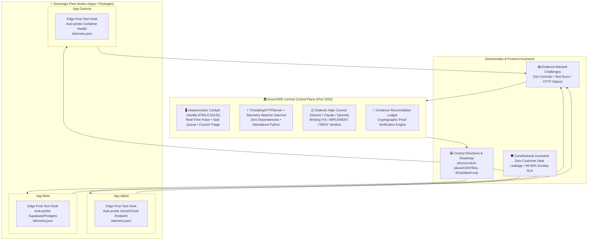

# AxiomSRE: Sovereign Fleet Control Plane & Autonomous Invariant Mesh

<p align="center">
  
</p>

<p align="center">
  <strong>The open-source SRE & Governance Control Plane for AI-orchestrated engineering fleets.</strong><br>
  <em>Govern 5 to 50 autonomous micro-applications or monorepo workspaces without architectural drift, infinite agent loops, or data boundary leaks.</em>
</p>

<p align="center">
  <a href="#why-axiomsre"></a>
  <a href="#the-4-invariant-pillars"></a>
  <a href="#the-loop-breaker-protocol"></a>
  <a href="#zero-bloat-stack"></a>
  <a href="LICENSE"></a>
</p>

---

## 🚀 Why AxiomSRE?

Autonomous AI coding agents (Gemini, Claude Code, Cursor, Copilot, Devin) have made code creation 100x faster, but **multi-repo fleet cohesion 100x harder**. 

When development teams unleash agents across multiple micro-services, packages, or sovereign repositories, three systemic failures occur:

1. **The Infinite Instruction Loop**: An agent finishes a task or challenges a directive, but because the central hub is a static document, the next agent session receives the stale command again, repeating work forever.
2. **The "Silent Edge Drift"**: Individual repositories deploy to Vercel/AWS/Cloudflare or mutate their databases without central visibility. Human leads don't realize an app's build failed until a customer reports it.
3. **Data Boundary Poisoning**: Developers accidentally dump database snapshots, customer PII, or internal credentials into agent context windows, violating compliance laws and security postures.

**AxiomSRE** provides the solution: an **autonomous, bi-directional SRE control plane** that unifies fleet telemetry, enforces constitutional invariants, breaks agent hallucination loops with cryptographic proof-of-work, and convenes a multi-model **Dialectic AI Council** to adjudicate technical debt and feature roadmaps.

---

## 🏛️ System Architecture

AxiomSRE operates as a **Federated Sovereign Mesh**. Whether you manage 6 independent Git repositories (polyrepo) or a unified Turborepo/Nx workspace (monorepo), each application remains sovereign while reporting operational telemetry to the central Hub.



---

## ⚡ The 4 Invariant Pillars of AxiomSRE

### Pillar 1: Constitutional Invariants (Zero PII Propagation)
Every AxiomSRE installation defines a non-negotiable `CONSTITUTION.md`. 
* **Section III Invariant**: Control plane telemetry and AI prompts are strictly prohibited from serializing customer, user, or transactional records.
* Only operational engineering metadata (git hashes, route paths, HTTP codes, latency percentiles, error stack traces, and slide outlines) are ingested.

### Pillar 2: The Bidirectional Loop-Breaker Protocol
Traditional command systems fail because feedback is one-way. AxiomSRE enforces **Evidence-Backed Challenges**:
* When an edge repository completes or disputes a directive, it submits proof:
  * `GIT_COMMIT_PROOF` (verified against git history)
  * `TEST_PASS_PROOF` (verified against test runner outputs)
  * `HTTP_STATUS_PROOF` (verified against live edge URLs)
* When verified, the engine executes a **Simultaneous Dual Mutation**:
  1. Mutates central records (`fleet-data.json` and dashboard status).
  2. Mutates edge instructions (`mvp-100-plan.md`), checking off completed items and advancing the prompt banner to the **next** pending task.
* **Result**: Zero infinite loops between autonomous coding agents.

### Pillar 3: Zero-Bloat, Zero-Dependency Core Engine
* The entire Control Plane runs on **Python standard library** (`http.server`, `socketserver`, `json`, `urllib`).
* No 500MB `node_modules` tree to audit or rebuild.
* Boots in 150 milliseconds. Consumes less than 35MB of RAM.
* Includes a built-in background `TelemetryWatcherThread` that detects file timestamp deltas every 15 seconds.

### Pillar 4: The Dialectic AI High Council
* Connects via OpenRouter, Google Gemini, Anthropic Claude, or OpenAI.
* Rather than a generic conversational assistant, the Council conducts structured judicial reviews:
  * **🔴 FIX MANDATE**: Defect violates performance SLA or security invariants. Issues P0 mitigation steps and target files.
  * **🟢 IMPLEMENT ACCEPTED**: Feature request adheres to constitutional boundaries and accelerates product roadmap.
  * **⛔ FORMALLY DENIED**: Request duplicates capability, violates data isolation, or creates tech debt. Issues formal rejection rationale.

---

## 🏁 Quickstart (Under 60 Seconds)

### 1. Launch the Mission Control Cockpit
```bash
python3 core/serve.py
```
Open **`http://localhost:3333`** in your browser.

### 2. Configure Edge Auto-Reporting
In any sovereign application repository or package:
```bash
cp edge-scaffolding/report-telemetry.py ./scripts/report-telemetry.py
```
Add to your `package.json` (or Makefile / Cargo.toml):
```json
"scripts": {
  "test": "jest",
  "posttest": "python3 scripts/report-telemetry.py --auto"
}
```
Now, whenever your test suite passes or a commit is created, the edge repository automatically probes its production edge and updates its local telemetry!

---

## 🗂️ Directory Blueprint

```
axiomsre/
├── README.md                      # Master Guide & Visual Documentation
├── ARCHITECTURE.md                # Mathematical Loop-Breaker Proof & Invariant Specification
├── LESSONS-LEARNED.md             # 10 Battle-Tested War Stories from Real-World Multi-App Fleets
├── core/
│   ├── serve.py                   # Multi-Threaded HTTP Server + Telemetry Watcher Daemon
│   ├── deliberation_engine.py    # OpenRouter / Gemini Dialectic Council & Synthesizer
│   ├── telemetry-schema.json      # Universal JSON Schema for fleet telemetry
│   ├── tasks-schema.json          # Machine-readable task schema
│   └── dashboard/                 # Glassmorphic Mission Control Cockpit (Port 3333)
│       ├── index.html
│       ├── app.js
│       └── style.css
├── edge-scaffolding/
│   ├── report-telemetry.py        # Generic auto-probing edge telemetry reporter
│   ├── challenge-central.py       # Bidirectional proof submission CLI
│   └── reconcile-challenges.py    # Dual-mutation reconciliation engine
├── council-prompts/
│   ├── gemini-prompts.md          # Google Gemini 2.5 Pro / Flash Council Dialectic Prompts
│   ├── claude-prompts.md          # Anthropic Claude 3.7 Sonnet Prompts
│   └── openai-prompts.md          # OpenAI o3 / GPT-4o Prompts
└── examples/
    ├── polyrepo-setup/            # 3-app distributed Git fleet example
    └── monorepo-setup/            # Turborepo / Nx workspace example
```

---

## 📄 License

Distributed under the **Apache 2.0 License**.
