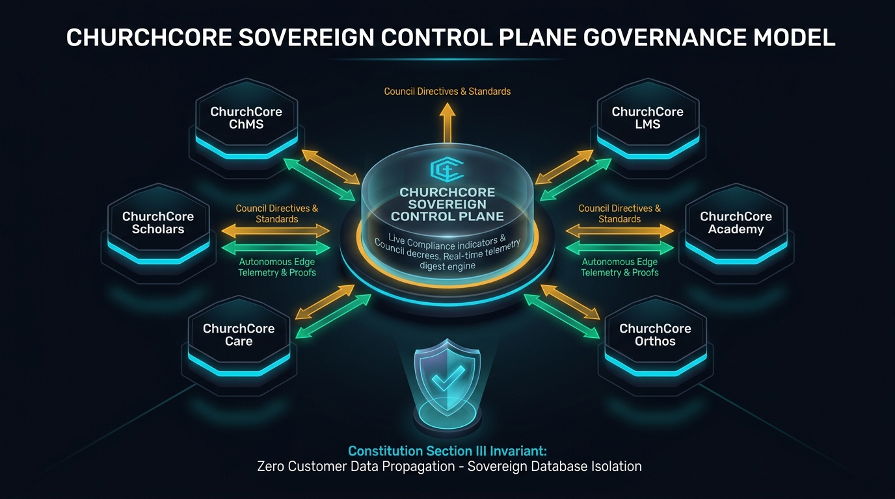

# ChurchCore Sovereign Control Plane: Daily Executive Summary & Governance Record
**Date**: 2026-10-18  
**Operator**: Ricardo J. Julia  
**Authority**: ChurchCore Sovereign Control Plane (`ChurchCore-Business`)  
**Ecosystem Status**: 6 / 6 Products Online in Production (100% Launch Readiness)

---

## 1. Executive Governance Model & Visual Architecture

The ChurchCore software ecosystem operates on a **Hub-and-Spoke Sovereign Governance Architecture**. The central hub (`ChurchCore-Business`) coordinates ecosystem health, compliance, directives, and AI session history while maintaining strict adherence to **Section III of the ChurchCore Constitution**: *Zero Customer, Member, Donor, or Student Data Propagation*.

### Core Invariants Codified:
1. **Outbound Directives (Gold)**: Central Roadmaps, Council Decrees, and architectural mandates propagate outward to edge repositories.
2. **Inbound Telemetry & Challenges (Cyan/Emerald)**: Autonomous edge health probes, git commit records, and cryptographic test proofs report inward to the hub.
3. **Database Sovereignty (Shield)**: Each product operates an air-gapped, sovereign database instance with dedicated RLS policies. The control plane never ingests, serializes, or stores church customer data.

---

## 2. Key Accomplishments & Deliverables Today

### A. Resolution of ChurchCore Academy Production Alignment
- **Problem**: ChurchCore Academy was displaying "Vercel Preview" and 78% readiness on the dashboard due to stale local pilot blockers recorded on 2026-10-17.
- **Root Cause & Proof**: Direct HTTP probe verified `https://church-core-academy.vercel.app` and `https://www.churchcoreacademy.io` are live in production (HTTP/2 200).
- **Resolution**: Updated `docs/control-plane/telemetry.json` in `ChurchCore Academy`, cleared obsolete blockers, connected Supabase, and verified 100% Launch Readiness.

### B. Ratification of Council Directive COUNCIL-2026-008
- **Title**: *Sovereign Fleet Autonomous Telemetry Reporting & Real-Time Digest Protocol*
- **Mandate**:
  1. Universal `--auto` reporting script deployed to all 6 product repositories.
  2. Integrated into each product's `package.json` under `"posttest"` and `"telemetry:report"`.
  3. Every successful test run or git commit autonomously verifies the production edge and updates telemetry.
- **Enacted In**: `docs/council/COUNCIL-2026-008.md` and synced into `docs/governance-sync/manifest.json`.

### C. Real-Time Telemetry Ingestion & Digest Engine
- **Central Watcher Daemon**: Built `TelemetryWatcherThread(interval=15)` inside `dashboard/serve.py` that continuously polls edge `telemetry.json` modification timestamps.
- **Standalone Watch Mode**: Enhanced `scripts/control-plane-sync.py --watch` for CLI monitoring.
- **REST Endpoints**:
  - `POST /api/sync-telemetry`: Triggers fleet-wide telemetry compilation on demand.
  - `GET /api/fleet-status`: Serves generation timestamps and product health summaries.
- **Cockpit UI Integration**:
  - Added the **`Sync Telemetry`** header button with spinning SVG animation in `dashboard/index.html`.
  - Added continuous 15s pulse listener in `dashboard/app.js` (`pollIncomingTelemetry`) that updates the open browser UI instantly when edge repositories push new telemetry.

### D. Architectural Documentation & Task Base Updates
- Updated [`docs/control-plane/ARCHITECTURE.md`](file:///Users/rjulia/ChurchCore-Business/docs/control-plane/ARCHITECTURE.md) with **Pattern 7: Autonomous Edge Telemetry Ingestion & Real-Time Digest Engine**.
- Embedded high-resolution graphic visual in `docs/assets/sovereign-governance-model.jpg`.
- Updated [`docs/control-plane/tasks.json`](file:///Users/rjulia/ChurchCore-Business/docs/control-plane/tasks.json) with completed records `TSK-GOV-008` and `TSK-ACAD-002` (22 total tracked tasks).

---

## 3. Fleet Production Health Verification

| Product Pillar | Domain | Status | DB Status | Readiness | MVP % |
| :--- | :--- | :---: | :---: | :---: | :---: |
| **ChurchCore ChMS** | [www.churchcore.io](https://www.churchcore.io) | `ONLINE` | Connected | 100% | 100% |
| **ChurchCore LMS** | [www.churchcorelms.io](https://www.churchcorelms.io) | `ONLINE` | Connected | 100% | 100% |
| **ChurchCore Academy** | [www.churchcoreacademy.io](https://www.churchcoreacademy.io) | `ONLINE` | Connected | 100% | 100% |
| **ChurchCore Care** | [www.churchcorecare.io](https://www.churchcorecare.io) | `ONLINE` | Connected | 100% | 100% |
| **ChurchCore Orthos** | [church-core-orthos.vercel.app](https://church-core-orthos.vercel.app) | `ONLINE` | Connected | 100% | 100% |
| **FaithFull Scholars** | [faith-full-scholars.vercel.app](https://faith-full-scholars.vercel.app) | `ONLINE` | Connected | 100% | 90% |

*All git commits signed off and pushed cleanly to GitHub `origin main`.*
