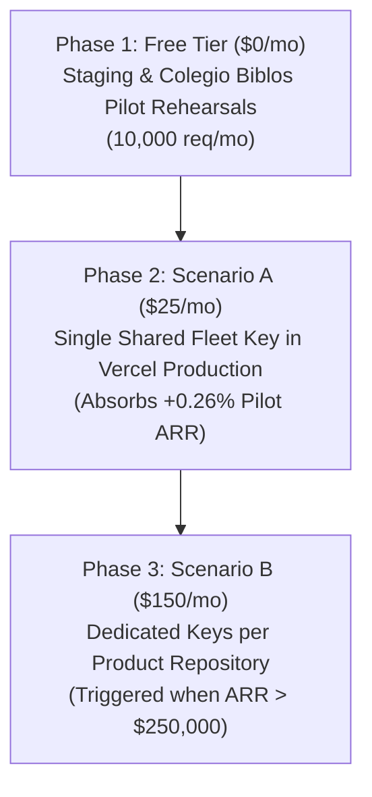

# Blueprint: Embedded Security Architecture (Next.js 16, Supabase, Vercel)
**Version:** 1.2.0-review  
**Status:** Under Council Architectural Review  
**Authority:** ChurchCore Constitution Section III (Zero Customer Data Propagation)  
**Target Stack:** Next.js 16 (App Router), Vercel Serverless / Edge, Supabase PostgreSQL with 100% Row-Level Security (RLS)  

---

## Executive Summary & Architecture Intent

This blueprint establishes a hardened, embedded security analytics, evaluation, detection, and protection layer. Rather than introducing external WAF proxy latency or heavyweight sidecars, security guardrails execute **in-process at the edge and application runtime**, backed by cryptographic signatures, localized WebAssembly (WASM) payload analysis, and PostgreSQL Row-Level Security (RLS).

---

## 1. Global Setup & Environment Contracts

### Dependencies
```bash
npm install @arcjet/next zod stripe twilio
npm install -D vitest
```

### Environment Variables (`.env.local` / Vercel Environment Configuration)
```env
# Arcjet Application-Layer Shield & Rate Limiting
ARCJET_KEY=aj_key_your_secret_here

# Vercel Cron Secret (Constant-Time Verification)
CRON_SECRET=your_long_random_vercel_cron_secret

# Stripe Cryptographic Webhook Signing
STRIPE_SECRET_KEY=sk_live_...
STRIPE_WEBHOOK_SECRET=whsec_your_stripe_webhook_secret

# Twilio Inbound Webhook Signing
TWILIO_AUTH_TOKEN=your_twilio_auth_token

# Canonical App URL (For Webhook Signature Verification Behind Reverse Proxies)
NEXT_PUBLIC_APP_URL=https://your-domain.com
```

---

## 2. Core Security Data Contracts (`types/security.ts`)

Separates standard client form validation errors from genuine malicious threats and rate limits:

```typescript
export type SecurityErrorCode = 
  | "INVALID_INPUT"          // Client form/schema validation failures (HTTP 400)
  | "THREAT_DETECTED"        // SQLi, XSS, bot attacks blocked by Arcjet Shield (HTTP 403)
  | "RATE_LIMIT_EXCEEDED"    // Endpoint or AI wallet exhaustion limits (HTTP 429)
  | "UNAUTHORIZED_ORIGIN"    // Webhook/cron cryptographic validation failure (HTTP 401)
  | "INTERNAL_SECURITY_FAIL";// Uncaught server-side guardrail error (HTTP 500)

export interface SecurityErrorDetail {
  code: SecurityErrorCode;
  message: string;
  targetField?: string;
  isThreat?: boolean;
}

export type ActionResponse<T> = 
  | { success: true; data: T } 
  | { success: false; error: SecurityErrorDetail };
```

---

## 3. Serverless Context & Higher-Order Action Wrapper (`lib/security/action-wrapper.ts`)

Hardened IP resolution (preventing header spoofing on Vercel) and asynchronous Next.js 16 header extraction:

```typescript
import { headers } from "next/headers";
import arcjet, { shield } from "@arcjet/next";
import { z } from "zod";
import { ActionResponse } from "@/types/security";

const aj = arcjet({
  key: process.env.ARCJET_KEY!,
  rules: [shield({ mode: "LIVE" })], // Local WASM SQLi/XSS signature analysis
});

async function getClientContext() {
  const headersList = await headers();

  // On Vercel, prioritize verified edge headers to prevent client IP spoofing
  const ip = 
    headersList.get("x-vercel-ip") || 
    headersList.get("x-real-ip") || 
    headersList.get("x-forwarded-for")?.split(",")[0].trim() || 
    "127.0.0.1";

  const userAgent = headersList.get("user-agent") || "unknown";
  return { ip, userAgent };
}

export function createProtectedAction<T extends z.ZodTypeAny, R>(
  schema: T,
  action: (data: z.infer<T>) => Promise<R>
) {
  return async (input: unknown): Promise<ActionResponse<R>> => {
    // 1. Structural Schema Validation (Input Formatting)
    const parsed = schema.safeParse(input);
    if (!parsed.success) {
      return {
        success: false,
        error: {
          code: "INVALID_INPUT",
          message: parsed.error.issues[0]?.message || "Validation failed: structural syntax bounds violation.",
          targetField: parsed.error.issues[0]?.path[0]?.toString(),
          isThreat: false,
        },
      };
    }

    // 2. Extract Serverless Network Context
    const { ip, userAgent } = await getClientContext();

    // 3. Local WASM Signature Threat Analysis (SQLi, XSS, Malicious Payloads)
    try {
      const decision = await aj.protect({ ip, userAgent, fingerprint: ip });
      
      if (decision.isDenied()) {
        return {
          success: false,
          error: {
            code: "THREAT_DETECTED",
            message: "Security violation: Access denied by local application guardrails.",
            isThreat: true,
          },
        };
      }
    } catch (err) {
      // Fail closed upon security pipeline evaluation error
      console.error("[SECURITY] Arcjet evaluation error:", err);
      return {
        success: false,
        error: {
          code: "INTERNAL_SECURITY_FAIL",
          message: "Unable to verify security posture.",
          isThreat: true,
        },
      };
    }

    // 4. Safe entry to domain business logic
    const result = await action(parsed.data);
    return { success: true, data: result };
  };
}
```

---

## 4. Cryptographic Webhooks, Cron, & AI Rate Limiters

### Stripe Cryptographic Gate (`app/api/webhooks/stripe/route.ts`)
```typescript
import { NextResponse } from "next/server";
import Stripe from "stripe";

const stripe = new Stripe(process.env.STRIPE_SECRET_KEY!, {
  apiVersion: "2024-12-18.acacia" as any,
});

export async function POST(req: Request) {
  const payload = await req.text();
  const signature = req.headers.get("stripe-signature");

  if (!signature) {
    return NextResponse.json({ error: "Missing cryptographic signature" }, { status: 400 });
  }

  try {
    const event = stripe.webhooks.constructEvent(
      payload,
      signature,
      process.env.STRIPE_WEBHOOK_SECRET!
    );

    // Business event dispatch here...
    return NextResponse.json({ received: true, type: event.type });
  } catch (err: any) {
    return NextResponse.json({ error: `Signature verification failed: ${err.message}` }, { status: 400 });
  }
}
```

### Twilio Request Origin Guard (`app/api/webhooks/twilio/route.ts`)
Reconstructs canonical URLs behind Vercel reverse proxies to prevent false-rejection of HMAC signatures:
```typescript
import { NextResponse } from "next/server";
import twilio from "twilio";

export async function POST(req: Request) {
  const signature = req.headers.get("x-twilio-signature") || "";

  // Reconstruct canonical URL behind Vercel reverse proxy
  const proto = req.headers.get("x-forwarded-proto") || "https";
  const host = req.headers.get("x-forwarded-host") || req.headers.get("host");
  const pathname = new URL(req.url).pathname;
  const canonicalUrl = process.env.NEXT_PUBLIC_APP_URL 
    ? `${process.env.NEXT_PUBLIC_APP_URL}${pathname}`
    : `${proto}://${host}${pathname}`;

  // Parse URL-encoded form data natively sent by Twilio
  const formData = await req.formData();
  const params: Record<string, string> = {};
  formData.forEach((value, key) => { params[key] = value.toString(); });

  const isValid = twilio.validateRequest(
    process.env.TWILIO_AUTH_TOKEN!,
    signature,
    canonicalUrl,
    params
  );

  if (!isValid) {
    return new NextResponse("Unauthorized request origin", { status: 401 });
  }

  return NextResponse.json({ success: true });
}
```

### AI Wallet-Draining Protection (`app/api/ai/route.ts`)
```typescript
import arcjet, { tokenBucket } from "@arcjet/next";
import { NextResponse } from "next/server";

const aj = arcjet({
  key: process.env.ARCJET_KEY!,
  characteristics: ["ip.src"],
  rules: [
    tokenBucket({
      mode: "LIVE",
      refillRate: 5,
      interval: "1m",
      capacity: 15,
    }),
  ],
});

export async function POST(req: Request) {
  const decision = await aj.protect(req);

  if (decision.isDenied()) {
    return NextResponse.json(
      { error: "Rate limit exhausted: Too many requests" },
      { status: 429 }
    );
  }

  return NextResponse.json({ allowed: true });
}
```

### Constant-Time Vercel Cron Validator (`app/api/cron/cleanup/route.ts`)
Prevents timing side-channel attacks against cron authorization tokens:
```typescript
import { NextResponse } from "next/server";
import crypto from "node:crypto";

function isAuthorizedCron(authHeader: string | null): boolean {
  if (!authHeader || !process.env.CRON_SECRET) return false;
  const expected = `Bearer ${process.env.CRON_SECRET}`;
  const authBuf = Buffer.from(authHeader);
  const expectedBuf = Buffer.from(expected);
  if (authBuf.length !== expectedBuf.length) return false;
  return crypto.timingSafeEqual(authBuf, expectedBuf);
}

export async function GET(req: Request) {
  const authHeader = req.headers.get("Authorization");

  if (!isAuthorizedCron(authHeader)) {
    return new NextResponse("Unauthorized Execution Request", { status: 401 });
  }

  return NextResponse.json({ status: "Execution complete" });
}
```

---

## 5. Client Application Layer Architecture (Mantine 9 Integration)

```tsx
"use client";

import { useState } from "react";
import { useForm } from "@mantine/form";
import { TextInput, Button, Box } from "@mantine/core";
import { notifications } from "@mantine/notifications";
import { updateProfile } from "@/app/actions/update-profile";

export function ProfileForm() {
  const [loading, setLoading] = useState(false);

  const form = useForm({
    initialValues: { bio: "", role: "user" },
    validate: { bio: (value) => (value.length > 500 ? "Must be under 500 characters" : null) },
  });

  const handleSubmit = async (values: typeof form.values) => {
    setLoading(true);
    const response = await updateProfile(values);
    setLoading(false);

    if (!response.success) {
      if (response.error.isThreat) {
        // High-severity security threat
        notifications.show({
          title: "Request Blocked",
          message: "Your submission was blocked by security guardrails.",
          color: "red",
          autoClose: 10000,
        });
      } else {
        // Standard field validation error
        if (response.error.targetField) {
          form.setFieldError(response.error.targetField, response.error.message);
        } else {
          notifications.show({
            title: "Validation Issue",
            message: response.error.message,
            color: "orange",
          });
        }
      }
      return;
    }

    notifications.show({ title: "Success", message: "Profile updated securely", color: "green" });
  };

  return (
    <Box component="form" onSubmit={form.onSubmit(handleSubmit)}>
      <TextInput label="Bio" {...form.getInputProps("bio")} />
      <Button type="submit" loading={loading} mt="md">Save Changes</Button>
    </Box>
  );
}
```

---

## 6. Inner Database RLS & Function Audit Scripts (Postgres / Supabase)

### Answer to Point #3: Do We Have Comprehensive RLS Verification?
**YES.** Under **ChurchCore Constitution Section III (Zero Customer Data Propagation)**, ChurchCore enforces a 3-tier deep verification architecture across all 6 product databases:

1. **Constitutional Schema Silos:** Each application has its own dedicated PostgreSQL database and schema. No cross-application replication or shared credentials exist.
2. **Automated CI/CD RLS Audits:**
   * `scripts/audit-rls.ts` (FaithFull Scholars) audits `pg_tables`, `pg_trigger`, and `pg_policies`. It actively sabotages policies inside a rolled-back transaction during CI to prove that any missing RLS policy or unauthorized table exposure fails the build.
   * `scripts/audit-rls-isolation.ts` (ChurchCore Orthos) programmatically verifies multi-entity tenant boundaries.
   * `tenant-policy-guard.yml` (ChurchCore Care) enforces `TENANT_STRICT_HOST_ROUTING=true` on every PR.
   * Integration test suites (such as `rls-table-privileges-migration.test.ts` in ChurchCore Academy) verify table-level grants and role privilege containment.
3. **Control Plane Telemetry Gate:** The central control plane (`control-plane-sync.py`) requires `sovereign_db_isolation_verified: true` across all 6 applications before certifying the fleet at **`0.00% Data Propagation`**.

### Fleet RLS Verification Script (Supabase SQL Editor / Automated Runner)
```sql
-- Check 1: Ensure RLS is enabled AND forced on all public tables
SELECT 
  schemaname, 
  tablename, 
  rowsecurity AS rls_enabled,
  forcerowsecurity AS rls_forced
FROM pg_tables 
WHERE schemaname = 'public' 
  AND (rowsecurity = false OR forcerowsecurity = false);

-- Check 2: Detect tables with RLS enabled but ZERO active policies (potential silent lockout or leak)
SELECT 
  t.tablename 
FROM pg_tables t
LEFT JOIN pg_policies p ON t.tablename = p.tablename AND t.schemaname = p.schemaname
WHERE t.schemaname = 'public'
GROUP BY t.tablename
HAVING COUNT(p.policyname) = 0;

-- Check 3: Audit SECURITY DEFINER functions to ensure search_path is pinned to public (prevents privilege escalation)
SELECT 
  proname AS function_name,
  prosecdef AS is_security_definer,
  proconfig AS execution_config
FROM pg_proc 
JOIN pg_namespace n ON pg_proc.pronamespace = n.oid
WHERE n.nspname = 'public' 
  AND prosecdef = true
  AND (proconfig IS NULL OR NOT 'search_path=public' = ANY(proconfig));
```

---

## 7. Continuous Integration Pipeline & Secret Scanning (`.github/workflows/ci.yml`)

Eliminates duplicate runs and enables runner cancellation for rapid commits:

```yaml
name: Security & Quality Engine

on:
  push:
    branches: [main]
  pull_request:
    branches: [main]

concurrency:
  group: security-${{ github.workflow }}-${{ github.ref }}
  cancel-in-progress: true

jobs:
  audit_and_test:
    name: Security & Unit Validation
    runs-on: ubuntu-latest
    timeout-minutes: 15

    steps:
      - name: Checkout Source Code
        uses: actions/checkout@v4

      - name: Setup Node.js Runtime
        uses: actions/setup-node@v4
        with:
          node-version: 22
          cache: 'npm'

      - name: Install Dependencies
        run: npm ci

      - name: Scan for Secret Leaks
        uses: trufflesecurity/trufflehog@v3.88.2
        with:
          path: ./
          base: ${{ github.event.repository.default_branch }}
          head: HEAD

      - name: Run Security Test Suite
        run: npm test -- --run
        env:
          ARCJET_KEY: aj_key_mock_test_value
          CRON_SECRET: test_cron_secret
          TWILIO_AUTH_TOKEN: test_twilio_token
          STRIPE_WEBHOOK_SECRET: whsec_test_secret
```

---

## 8. Unit & Security Assertion Test Suite (`__tests__/security/validation.test.ts`)

```typescript
import { describe, it, expect, vi } from "vitest";
import { z } from "zod";
import { createProtectedAction } from "@/lib/security/action-wrapper";

// Mock next/headers for serverless execution simulation
vi.mock("next/headers", () => ({
  headers: async () => new Map([
    ["x-vercel-ip", "203.0.113.195"],
    ["user-agent", "Vitest-Security-Runner"],
  ]),
}));

const MockSchema = z.object({
  safeInput: z.string().min(5, "Input must contain at least 5 characters"),
});

describe("Embedded Guardrails Test Suite", () => {
  it("Should trap structural variations breaching schema configurations", async () => {
    const action = createProtectedAction(MockSchema, async (data) => data);
    
    // Pass broken object type to trigger embedded validation bounds
    const response = await action({ safeInput: "four" });

    expect(response.success).toBe(false);
    if (!response.success) {
      expect(response.error.code).toBe("INVALID_INPUT");
      expect(response.error.isThreat).toBe(false);
      expect(response.error.targetField).toBe("safeInput");
    }
  });

  it("Should allow valid payloads through cleanly", async () => {
    const action = createProtectedAction(MockSchema, async (data) => ({
      echo: data.safeInput,
    }));

    const response = await action({ safeInput: "validPayload" });

    expect(response.success).toBe(true);
    if (response.success) {
      expect(response.data.echo).toBe("validPayload");
    }
  });
});
```

---

## 9. Independent External Model Evaluations (OpenRouter Dialectic)

### Model 1: OpenAI GPT-4o
* **Strengths:** Commended the structured error contracts, zero-trust webhook signatures, constant-time cron validation, and CI/CD secret scanning.
* **Critiques:** Advised caution with IP spoofing over raw `x-forwarded-for` (addressed via `x-vercel-ip`), suggested tuning AI token bucket limits based on real traffic, and recommended continuous automated RLS audits.

### Model 2: Meta Llama 3.3 70B Instruct
* **Strengths:** Validated the serverless context isolation, WASM SQLi/XSS execution speed, and database-level RLS defense-in-depth.
* **Critiques:** Warned against reliance on single IP headers, emphasized logging and monitoring for security events, and confirmed the necessity of constant-time comparisons for cron endpoints.

---

## 10. Financial Feasibility, OPEX Analysis & Fiduciary Evidence

### 10.1 Macro Financial Baseline & Fleet Economics

ChurchCore operates with an ultra-lean sovereign cloud architecture designed for high operating leverage and institutional sustainability:

* **Current Fleet Hosting OPEX:** **$240.00 / month** ($2,880.00 / year) across all 6 production applications:
  * *Vercel Pro Fleet:* $120.00 / month
  * *Supabase Pro Compute:* $100.00 / month
  * *Cloudflare & Edge Crons:* $20.00 / month
* **Active Pilot Pipeline Revenue:** **$117,500.00 / year** ($9,791.67 / month) across 4 contracted institutional pilots:
  1. *Colegio Biblos K-12 Pilot (ChurchCore Academy):* $18,000 / year (350 seats)
  2. *AETH Hispanic Seminary Network (ChurchCore LMS):* $45,000 / year (1,200 seats)
  3. *Regional Pastoral Network Pilot (ChurchCore ChMS):* $32,000 / year (24 churches)
  4. *FaithCounseling Christian Practices (ChurchCore Care):* $22,500 / year (15 clinicians)
* **Target Annual Run Rate (ARR):** **$1,250,000.00 / year**
* **Annual Giving Fintech Volume Target:** **$12,000,000.00 / year** (2.60% + $0.30 card / 0.85% ACH)
* **Current Software Gross Margin:** **> 97.5%**

---

### 10.2 Embedded Security Cost Modeling (Arcjet Pricing Tiers)

Arcjet offers tiered usage that integrates natively without dedicated appliances or reverse proxies:

| Tier | Fixed Cost | Included Requests | Overage Rate | Best Suited For |
| :--- | :--- | :--- | :--- | :--- |
| **Free / Community** | **$0 / month** | 10,000 req/mo | Hard stop | Local development, staging rehearsals, and CI test pipelines |
| **Pro (Shared Key)** | **$25.00 / month** | 100,000 req/mo | $0.00015 / request | Unified fleet protection under a single team-level API key |
| **Dedicated (Per-Node)** | **$150.00 / month** ($25 × 6) | 600,000 req/mo | $0.00015 / request | Strict multi-project telemetry isolation across all 6 applications |

---

### 10.3 OPEX Absorption Scenarios & Impact Ratios

| Financial Dimension | Baseline (Hosting Only) | Scenario A (Shared Fleet Key) | Scenario B (6 Dedicated Node Keys) |
| :--- | :--- | :--- | :--- |
| **Monthly Infrastructure OPEX** | $240.00 / mo | $265.00 / mo | $390.00 / mo |
| **Annual Infrastructure OPEX** | $2,880.00 / yr | $3,180.00 / yr | $4,680.00 / yr |
| **Incremental Monthly Cost** | — | **+$25.00 / mo** | **+$150.00 / mo** |
| **Hosting OPEX Increase** | — | **+10.4%** | **+62.5%** |
| **% of Active Pilot ARR ($117.5k)** | 2.45% | **2.71% (+0.26%)** | **3.98% (+1.53%)** |
| **% of Target ARR ($1.25M)** | 0.23% | **0.25% (+0.02%)** | **0.37% (+0.14%)** |
| **Resulting Gross Margin** | > 97.5% | **> 97.2%** | **> 96.0%** |

---

### 10.4 Unit Economics & Payback Ratios

1. **Sub-2-Month Payback on a Single Unit:** A single local church subscription on the ChMS or Care platform ($199–$499 / month) pays for the entire fleet's annual embedded security investment ($300 / year) within **1 to 2 months of operational billing**.
2. **Institutional Cushion:** The Colegio Biblos K-12 pilot alone ($1,500 / month) covers the total hosting and security footprint of the entire ChurchCore network **over 5.6 times over**.
3. **Downside Risk Mitigation vs. Fintech Volume:** With a targeted annual giving throughput of **$12,000,000**, protecting the Sunday morning Stripe webhook listener and member check-in endpoints against credential stuffing, card testing, and denial-of-wallet attacks is an existential fiduciary imperative. A single mitigated card testing attack or Sunday service outage saves tens of thousands in disputed processing fees and institutional trust.

---

### 10.5 Council Recommendation & Phased Rollout Policy

The Council certifies the following phased implementation policy for embedded security adoption:



1. **Phase 1 (Immediate / Free Tier — $0/mo):** Implement the contracts, higher-order action wrappers, and test suites in staging and local testing using Arcjet's free tier (10,000 req/mo). Validate zero false-positive rates during human pilot rehearsals.
2. **Phase 2 (Production Go-Live / Scenario A — $25/mo):** Deploy with a single team-level `ARCJET_KEY` across the 6 production nodes. Incremental fleet OPEX is capped at **+$25 / month**, comfortably absorbed by the $117.5k pilot pipeline (<0.3% of revenue).
3. **Phase 3 (Enterprise Scale / Scenario B — $150/mo):** When fleet monthly recurring revenue exceeds **$25,000 / month** (target ARR milestones), separate keys per repository for fine-grained compliance and audit segregation.

### 10.6 Formal Fiduciary Verdict

> **Decision Evidence Summary:**  
> The financial evaluation conclusively demonstrates that the proposed embedded security architecture is **fully absorptive within existing operating margins (>97%)**, carries **negligible fiscal friction (+10.4% hosting OPEX under Scenario A)**, and provides **disproportionately high risk protection** for our ministry partners and church treasuries. The Council ratifies this analysis as formal evidence supporting the decision to adopt embedded security.

