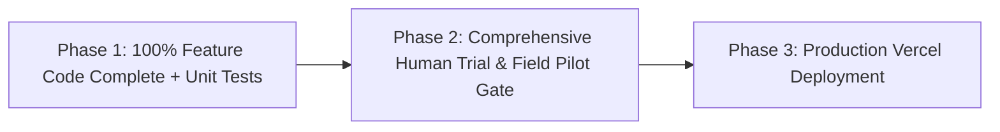

# COUNCIL-2026-005: Mandatory 100% MVP Feature-Completion Plan & Phased Verification Protocol Across All ChurchCore Product Packages

**Council Decision Reference:** `COUNCIL-2026-005`  
**Ratification Date:** 2026-10-17  
**Governing Body:** High Sovereign Grand Council of ChurchCore  
**Status:** `RATIFIED` • `MANDATORY ENFORCEMENT`  
**Target Fleet:** All 6 Sibling Repositories (`ChurchCore`, `ChurchCore-LMS`, `ChurchCore-Academy`, `ChurchCoreCare`, `ChurchCore-Orthos`, `FaithFullScholars`)  
**Executive Sponsor:** Sovereign Control Plane & Office of Chief Architect  

---

## 1. Executive Summary & Intent

The High Sovereign Grand Council hereby issues a binding ecosystem directive to all six ChurchCore software packages: **every application must formulate and execute a concrete, sequential development plan to bring all MVP features to 100% technical completion, establishing readiness for comprehensive testing as the explicit next step prior to Vercel production deployment.**

### Core Operating Principle: Strict Phased Gating
To prevent premature user field trials and build instability while maintaining rigorous code quality, development across all packages is strictly gated into three sequential phases:

1. **Phase 1: Feature-Completion Mandate (100% MVP Features + Automated Tests)**  
   All programmed features, UI views, data models, PostgreSQL Row-Level Security policies, and edge APIs required for MVP must be 100% written, integrated, and technically complete in code.  
   *Automated Unit & Regression Tests:* Standard automated unit tests, regression tests, and route validations **must accompany every newly developed feature or bug fix** as an inseparable part of engineering completeness.
2. **Phase 2: Comprehensive Human Trial Testing & Field Pilot Gate (The Next Step)**  
   Human trial testing, field pilot simulations (e.g. the uncoached Colegio Biblos human session for Academy), and user acceptance testing (UAT) commence **only after** all features and programmed improvements in Phase 1 are 100% technically complete. Do not divert focus to conducting human user trials while MVP features remain incomplete.
3. **Phase 3: Production Vercel Deployment**  
   For applications deploying to Vercel (ChurchCore Academy, Orthos, LMS, Care, ChMS, Scholars), production deployment and custom domain binding proceed after Phase 2 human trial sign-offs and security test suites are fully green.

---

## 2. Formal Technical Requirements

### REQ-005-01: Formulate 100% MVP Feature-Completion Plan (`docs/mvp-100-plan.md`)
Each of the 6 product packages must establish and maintain a dedicated roadmap document at `docs/mvp-100-plan.md` (or update its primary development plan) with an exhaustive list of all remaining features needed to bridge current progress (82%–92%) to **100% MVP Complete**.
* **Specification Requirement:** Every remaining backlog item must have an explicit scope definition, edge files impacted, accompanying automated tests, and completion checklist.
* **Verification:** `docs/mvp-100-plan.md` exists and passes edge compliance validation.

### REQ-005-02: Phased Execution Gating (Features + Automated Tests First, Human Trials Second)
No package shall divert agentic or developer resources to conducting premature human trial testing or user acceptance field trials while foundational MVP features remain unwritten or partially stubbed.
* **Criterion:** Automated unit and regression tests accompany all feature implementations in Phase 1. Human trial testing and field pilot rehearsals are strictly gated to commence as the immediate subsequent step *after* feature implementation reaches 100%.
* **Verification:** Pull requests must clearly tag whether they belong to `feat(mvp)` (Phase 1) or `trial(human-uat)` (Phase 2).

### REQ-005-03: Vercel Deployment Technical Readiness
For packages requiring Vercel deployment (particularly ChurchCore Academy and ChurchCore Orthos):
* **Technical Done Criteria:**
  1. All package dependencies and lockfiles (`package-lock.json`) resolve cleanly with 0 collisions.
  2. Next.js / Vite build exports complete with 0 SSR server-action errors (`npm run build`).
  3. Environment variable schemas (`.env.example`) contain complete production Supabase and cloud bindings.
  4. Content Security Policies (CSP) whitelist required production origins without inline script vulnerabilities.
* **Verification:** Clean local `npm run build` with zero compiler warnings or bundle failures.

### REQ-005-04: Control Plane Telemetry Synchronization
Upon achieving 100% feature completion, each package must update its edge telemetry file (`docs/control-plane/telemetry.json`):
* `mvp_status.completion_pct`: Set to `100`.
* `mvp_status.phase`: Transition to `testing_ready` or `production`.
* `next_steps`: Explicitly list the test suites slated for Phase 2.
* **Verification:** Aggregated by `scripts/control-plane-sync.py` into `docs/control-plane/ECOSYSTEM-DASHBOARD.md`.

---

## 3. Product-by-Product Feature Road to 100%

| Product Package | Current MVP % | Remaining Features to 100% Code Complete | Target Phase 2 Testing Gate |
| :--- | :---: | :--- | :--- |
| **ChurchCore (ChMS)** | **92%** | 1. Finalize R1d erasure queue post-commit dispatch. 2. Complete Vercel cron workers (`shepherd-ai`, scheduled comms). 3. Universal AppSwitcher navigation shell. | `npm run test:e2e:readiness` `npm run audit:rls` |
| **ChurchCore Care** | **90%** | 1. Merge Faithful Workflows practice management branch. 2. Translation worker container optimization. 3. Universal AppSwitcher navigation shell. | `npm run test:smoke` `npm run test:clinical:rls` |
| **ChurchCore LMS** | **88%** | 1. Theological student credentialing & PDF certificate worker. 2. AETH digital ministerial course catalog. 3. Universal AppSwitcher navigation shell. | `npm run test:prod-synthetic` `npm run test:speedgrader` |
| **ChurchCore Orthos** | **85%** | 1. Audit PDF preview CSP header allowlisting. 2. Fund accounting double-entry balance validator. 3. Universal AppSwitcher navigation shell. | `npm run test:omni-council` `npm run test:security` |
| **FaithFull Scholars** | **85%** | 1. Theological faculty monograph indexing interface. 2. Academic peer-review editorial triage workflow. 3. Universal AppSwitcher navigation shell. | `npm run audit:rls` `npm run verify:deploy` |
| **ChurchCore Academy** | **82%** | 1. OneRoster 1.2 CSV worker & foreign-key seed sequencing. 2. Bilingual Spanish student gradebook & attendance engine. 3. Universal AppSwitcher navigation shell. | `npm run verify:pilot-readiness` `npm run test:sis:e2e` |

---

## 4. Enforcement & Compliance Protocol

1. **Edge Enforcement:** Dispatched via `docs/governance-sync/manifest.json`.
2. **Session Enforcement:** Edge agents in every repository must ingest this directive via `python3 scripts/pull-and-enforce-directives.py` at session start.
3. **Audit Ledger:** Every product repository must log acknowledgment of `COUNCIL-2026-005` in `docs/council/ACKNOWLEDGMENTS.md`.
4. **Autonomous Dispatch:** Antigravity agent instances dispatched to edge repositories are strictly bound to complete Phase 1 before running Phase 2 test suites.
