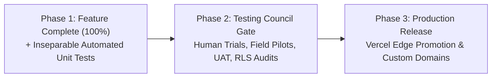

# COUNCIL-2026-006: Sovereign Testing Council Protocol, 3-Phase Verification Lifecycle & Mandatory Inseparable Automated Testing Standard Across All ChurchCore Product Repositories

**Council Decision Reference:** `COUNCIL-2026-006`  
**Ratification Date:** 2026-10-18  
**Governing Body:** High Sovereign Grand Council of ChurchCore  
**Status:** `RATIFIED` • `MANDATORY ENFORCEMENT`  
**Target Fleet:** All 6 Sibling Repositories (`ChurchCore`, `ChurchCore-LMS`, `ChurchCore-Academy`, `ChurchCoreCare`, `ChurchCore-Orthos`, `FaithFullScholars`)  
**Executive Sponsor:** Sovereign Control Plane & Office of Chief Architect  

---

## 1. Executive Summary & Intent

By unanimous decree of the High Sovereign Grand Council, the **ChurchCore Testing Council Protocol** is hereby formally ratified and established as the **mandatory, universal standard operating procedure across all six product repositories** in the ChurchCore sovereign ecosystem.

### Core Operating Principle: Universal 3-Phase Verification Lifecycle

To permanently eradicate the dual hazards of premature user field trials and deferred test engineering, all development and verification across the fleet is bound to three sequential, irreversible phases:

1. **Phase 1: 100% Feature-Completion & Inseparable Automated Testing Mandate**  
   All programmed features, edge APIs, UI workflows, database schemas, and edge integrations required for MVP must be 100% technically complete and ready for deployment.  
   *The Inseparable Testing Invariant:* Automated unit tests, integration tests, and regression tests **MUST accompany every newly developed feature or bug fix as an inseparable component of engineering completeness**. Writing tests may never be deferred to Phase 2.
2. **Phase 2: Testing Council Gate (Human Trial Testing & Field Pilots)**  
   Human trial testing (human rehearsals, field pilot trials like the uncoached Colegio Biblos human session, user acceptance testing (UAT), and uncoached live simulations) commences **ONLY after** all features and programmed improvements in Phase 1 are 100% technically complete. Do not organize or conduct human trial tests while MVP features remain incomplete.
3. **Phase 3: Production Vercel Deployment & Live Release**  
   For packages deploying to Vercel (ChurchCore Academy, Orthos, LMS, Care, ChMS, Scholars), clean build exports (`npm run build`), dependency lockfile resolution, and environment bindings must be verified prior to production launch.

---

## 2. Formal Technical Requirements

### REQ-006-01: Universal Institutionalization of the Testing Council
Every product repository must formally institutionalize the Testing Council protocol within `.agents/rules/churchcore-control-plane.md` and track execution state in its canonical roadmap (`docs/mvp-100-plan.md`). All AI agents and human contributors are bound to this order.
* **Verification:** Presence and enforcement of Section 2 in `.agents/rules/churchcore-control-plane.md` and acknowledgment in `docs/council/ACKNOWLEDGMENTS.md`.

### REQ-006-02: Inseparable Automated Testing Invariant
No pull request or feature task may be marked as complete if automated unit/regression tests are missing. Phase 2 is strictly reserved for human trial testing, field pilot simulations, and live SLA stress testing.
* **Criterion:** `npm test` or `python3 -m unittest` passes with 100% green status on all Phase 1 PRs.
* **Verification:** CI automated test pass on all feature branches prior to merge.

### REQ-006-03: Sovereign Control Plane Split Priority & Gate Architecture
The Executive Mission Control dashboard shall represent this dual lifecycle by maintaining a split architecture: an in-progress priority queue on the left (ranking applications by backlog percentage) and a dedicated Phase 2 Testing Gate Spotlight on the right rail (celebrating 100% Phase 1 graduates and displaying their active field pilot workstreams).
* **Criterion:** 100% Phase 1 applications are spotlighted on the Phase 2 Testing Gate rail rather than cluttering the active feature backlog.
* **Verification:** Rendered in `http://localhost:3333/` with emerald green `🟢 PHASE 2 · TESTING GATE` badge.

### REQ-006-04: Closed-Loop Governance Challenge & Non-Stalling Resolution
Whenever an edge repo AI agent or developer submits proof of work via `scripts/challenge-central-record.py`, the Sovereign Control Plane CI workflow (`.github/workflows/reconcile-governance-challenge.yml`) shall automatically evaluate, ratify, and auto-merge the evidence within ~30s, automatically advancing instructions to prevent infinite command-challenge loops.
* **Criterion:** Zero human stalling required for valid, verified governance evidence submissions.
* **Verification:** Automated PR review event `APPROVE` and squash merge executed in GitHub Actions.

---

## 3. Product-by-Product Status & Testing Gate Mapping

| Product Package | Current MVP % | Active Phase | Target Phase 2 Testing Gate |
| :--- | :---: | :---: | :--- |
| **ChurchCore Academy** | **100%** | **Phase 2 Gate** | **Active Field Pilot:** Colegio Biblos uncoached participant-browser session and uncached login validation (`npm run verify:pilot-readiness`). |
| **ChurchCore Orthos** | **85%** | Phase 1 (#1 Fleet Priority) | Fund accounting double-entry balance validator & PDF preview CSP header allowlisting. |
| **FaithFull Scholars** | **85%** | Phase 1 (#2 Priority) | Theological faculty monograph indexing interface & academic peer-review triage workflow. |
| **ChurchCore LMS** | **88%** | Phase 1 (#3 Priority) | Theological student credentialing & PDF certificate worker; AETH ministerial course catalog. |
| **ChurchCore Care** | **90%** | Phase 1 (#4 Priority) | Faithful Workflows practice management branch merge & translation worker container optimization. |
| **ChurchCore (ChMS)** | **92%** | Phase 1 (#5 Priority) | R1d data-rights erasure approval queue post-commit dispatch; Vercel Edge cron workers. |

---

## 4. Enforcement & Compliance Protocol

1. **Edge Enforcement:** Dispatched via `docs/governance-sync/manifest.json` (v1.2.0).
2. **Session Enforcement:** Edge agents in every repository must ingest this directive via `python3 scripts/pull-and-enforce-directives.py` at session start.
3. **Audit Ledger:** Every product repository must log acknowledgment of `COUNCIL-2026-006` in `docs/council/ACKNOWLEDGMENTS.md`.
4. **Universal Synchronization:** `scripts/activate-product-repos.py` shall propagate this standardized rule across all 6 sibling product repositories.
